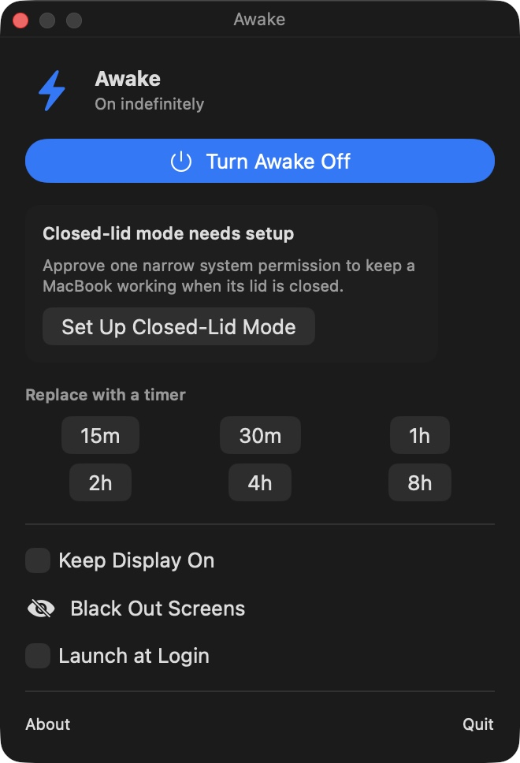

# Awake

Awake is a small macOS menu bar app that prevents idle system sleep, including when a MacBook lid is closed. It has one native power assertion, an optional display assertion, reliable timers, and a reversible screen-blackout shortcut.

It has no daemon, agent watcher, lease system, resident privileged process, private display API, analytics, or updater. Closed-lid sessions call a small root-owned command that coordinates the system-wide setting across users and exits immediately.

## Install

Requires macOS 13 or newer.

```bash
npx --yes awake-agent install
```

For a local checkout:

```bash
./install.sh
```

The installer builds a universal Apple Silicon and Intel app at `~/.local/bin/Awake.app`, opens it, and starts an indefinite session. After that, use the labeled moon or bolt in the menu bar. Left-click opens the control panel and right-click opens the quick menu. If a menu-bar organizer hides it, press `Control-Shift-A` or run `awake ui`.

## Menu

- Start indefinitely, or for 15 minutes, 30 minutes, 1, 2, 4, or 8 hours
- Stop at any time
- Keep Display On is optional and off by default
- Keep Working With Lid Closed uses one administrator-approved power setting
- Black Out Screens covers every connected display with a black overlay
- Launch at Login uses the standard macOS login-item service

Press `Option-1` to toggle screen blackout. `Escape` also restores the screens. Blackout never changes physical monitor or keyboard brightness.

Selecting a timer while Awake is already on replaces the indefinite session with that deadline. The right-click quick menu also has a separate Extend action for an existing timer.

Timers use an absolute deadline and release the power assertion as soon as they reach zero. Awake never forces the Mac to sleep. It only prevents or allows normal idle sleep.

Closed-lid support changes only `pmset disablesleep` while at least one Awake user owns an active session. Awake restores the prior system value after the last session stops, on timer expiry, normal quit, uninstall, or the next launch after an interrupted session. It never changes sleep timers, standby, hibernation, or display brightness.

## CLI

```text
awake on
awake for 30m
awake until 17:30
awake off
awake nosleep-display
awake blackout
awake screens show
awake status --json
awake ui
```

The CLI writes a one-shot command to the running menu bar app. It does not start a background runtime.

## Build and verify

```bash
npm test
./awake-build-ui
./package-app.sh
```

Local builds are ad-hoc signed. Public distribution still requires Apple Developer ID signing and notarization.


